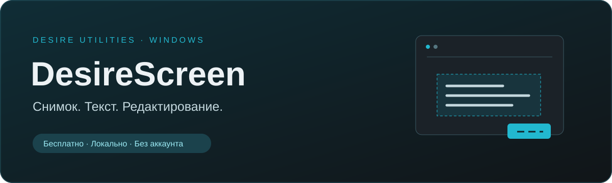
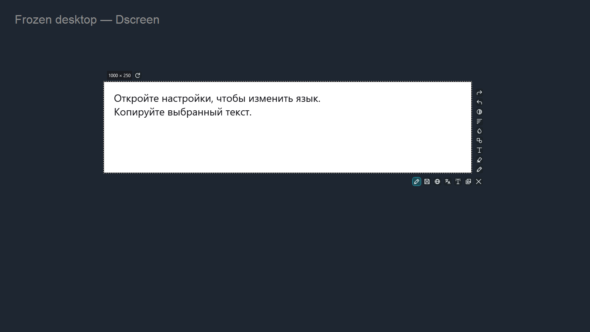
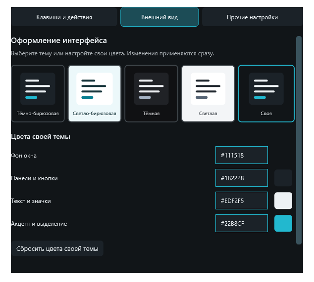

  
  

<b>Выделите область. Скопируйте изображение или текст. Добавьте пометки.</b> DesireScreen — бесплатная утилита для Windows с редактором, OCR и необязательным локальным переводом.

## Скачать

| Файл | Для чего |
| --- | --- |
| [DesireScreen-0.3.0-win-x64.zip](https://github.com/500EFKA500/DesireScreen/releases/download/v0.3.0/DesireScreen-0.3.0-win-x64.zip) | Основное приложение: снимки, редактор, OCR, темы. |
| [DesireScreen-Translation-0.3.0.dscreenpack](https://github.com/500EFKA500/DesireScreen/releases/download/v0.3.0/DesireScreen-Translation-0.3.0.dscreenpack) | Необязательное дополнение с офлайн-переводом английский ↔ русский. |
| [SHA256SUMS.txt](https://github.com/500EFKA500/DesireScreen/releases/download/v0.3.0/SHA256SUMS.txt) | Контрольные суммы файлов выпуска. |

**Windows x64; рекомендуется Windows 11.** На Windows 10 совместимость зависит от редакции и версии системы; отдельная проверка пока не проводилась. [Поддерживаемые системы .NET 10](https://github.com/dotnet/core/blob/main/release-notes/10.0/supported-os.md). Для OCR нужны компоненты распознавания соответствующих языков Windows. .NET и Python отдельно устанавливать не требуется.

## Всё нужное рядом со снимком

- **Захват области или монитора.** Замороженный рабочий стол, изменение границ и обновление кадра одной кнопкой.
- **Редактор.** Перо, маркер, стрелки, рамки, овалы, заливка и надписи с перемещением и поворотом. Цвет, толщина, прозрачность, отмена и повтор.
- **Текст со снимка.** Распознавание русского и английского текста средствами Windows.
- **Сохранение.** PNG, JPG/JPEG, BMP, GIF и TIFF; обычный диалог или автоматическое сохранение в сценарии.
- **Свои сочетания.** Область/экран и цепочка действий: скопировать, отредактировать, сохранить, закрыть.
- **Темы.** Тёмно-бирюзовая, светло-бирюзовая, тёмная, светлая и собственные цвета.

## Первый запуск

1. Скачайте ZIP основного приложения и распакуйте **всю папку** на локальный диск.
2. Запустите `DesireScreen.exe`. Соседние файлы нужны приложению; переносите папку целиком.
3. Нажмите **Ctrl+Shift+Q** и выделите область.
4. Значок Desire рядом с часами открывает настройки. Крестик настроек скрывает окно, выход — через меню трея.

При первом запуске Windows может показать предупреждение для нового неподписанного приложения. Проверяйте адрес официального репозитория и контрольную сумму. У приложения нет цифровой подписи издателя Windows; подпись дополнения — отдельная внутренняя проверка пакета.

| Сочетание в захвате | Действие |
| --- | --- |
| Ctrl+A | Выбрать весь текущий монитор |
| Ctrl+C / Enter | Скопировать изображение |
| Ctrl+S | Сохранить изображение |
| Ctrl+Z / Ctrl+Y | Отмена / повтор |
| Esc | Отменить ввод, закрыть панель или захват |

В текстовых полях обычные сочетания работают с текстом. Глобальные бинды можно изменить; системные и занятые сочетания могут быть недоступны.

## Локальный перевод — по желанию

Обычный DesireScreen не содержит моделей и не показывает кнопки перевода.

1. Скачайте файл `.dscreenpack` из этого же выпуска.
2. Откройте **Прочие настройки → Локальный перевод → Установить из файла…**.
3. Выберите пакет и дождитесь проверки подписи, целостности и пробного перевода.
4. Появятся перевод, выбор языков и действия перевода в сценариях.

Перевод работает на процессоре без интернета, API-ключей и аккаунтов. Загрузка модели может занять несколько секунд. Можно отключить дополнение в настройках; сценарии перевода сохранятся и снова станут доступны после установки. Для переноса на другой ПК копируйте всю папку приложения вместе с `addons`.

## Приватность

Снимки и распознанный текст не отправляются на сервер. В приложении нет телеметрии и рекламных модулей. Интернет используется только по явной кнопке открытия страницы скачивания в браузере. Настройки и журнал ошибок хранятся локально в `%LOCALAPPDATA%\Dscreen`.

## Что учитывать

Это ранний публичный выпуск. Качество OCR зависит от Windows и читаемости снимка; перевод не гарантирует точность специальной терминологии. Под переводом используется однотонная подложка. Разные DPI и несколько мониторов требуют дополнительной проверки. Пока нет установщика, автоматического обновления и подписанного сертификатом издателя EXE.

## Обратная связь

[Создать сообщение об ошибке](https://github.com/500EFKA500/DesireScreen/issues/new): укажите версию DesireScreen, версию Windows, шаги воспроизведения и результат. Не прикладывайте личные снимки или настройки с секретами.

## Лицензия и исходники

DesireScreen распространяется бесплатно с закрытыми исходниками. Этот репозиторий — публичная витрина и место распространения готовых выпусков. Исходного проекта и его истории здесь нет. Условия использования — [LICENSE.md](LICENSE.md). Сторонние компоненты имеют собственные лицензии: [THIRD_PARTY.md](THIRD_PARTY.md); оригинальные уведомления также включены в файлы выпуска.